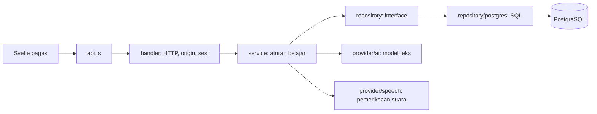

# Peta kode Miva

Miva adalah nama produk. Nama modul Go `english-app`, cookie sesi, route HTTP, schema PostgreSQL, dan format JSON dipertahankan agar instalasi lama tetap cocok.

## Titik masuk

Frontend dimulai dari `frontend/src/main.js` → `App.svelte`. State lintas halaman, antrean draft, polling pekerjaan, dan suara browser dimiliki `App.svelte`; halaman di `pages/` menerima data dan callback. Permintaan server melalui `frontend/src/api.js`.

Backend dimulai dari `backend/main.go` → `internal/app/bootstrap.go`. Bootstrap membaca konfigurasi, membuka database, memeriksa migrasi, membuat repository dan provider, memasangnya ke service, lalu menyalakan handler HTTP. Panduan file lengkap ada di [backend/README.md](../backend/README.md).

Service menerima provider melalui interface; diagram menunjukkan alur pemanggilan. Provider tidak mengimpor service. Model merupakan kontrak data bersama, tanpa koneksi database atau transport HTTP.

## Identitas fitur

Path backend berikut relatif terhadap `backend/internal/`.

| Identitas         | Tanggung jawab                    | Titik baca backend                                                                                   |
| ----------------- | --------------------------------- | ---------------------------------------------------------------------------------------------------- |
| `MIVA-AUTH`       | Login, daftar, sesi               | `handler/auth.go` → `service/auth.go` → `repository/postgres/users.go`                               |
| `MIVA-PLAN`       | Pilihan materi dan validasi       | `model/study.go`, `provider/ai/learning.go`                                                          |
| `MIVA-JOBS`       | Persiapan sesi latar belakang     | `handler/studies.go` → `service/studies.go` → `repository/postgres/jobs.go`                          |
| `MIVA-STUDY`      | Materi, draft, penilaian, riwayat | `handler/lessons.go` → `service/lessons.go` → `repository/postgres/lessons.go`, `lesson_progress.go` |
| `MIVA-WORDS`      | Kamus dan verb                    | `handler/words.go` → `service/words.go` → `repository/postgres/words.go`                             |
| `MIVA-READING`    | Latihan baca dan pelafalan        | `service/reading.go`, `reading_alignment.go`, `provider/speech/assessment.go`                        |
| `MIVA-CHAT`       | Tutor bilingual                   | `handler/chat.go` → `service/chat.go` → `repository/postgres/messages.go`                            |
| `MIVA-AUDIO`      | Sumber teks suara perangkat       | `handler/audio.go` → `service/audio.go`                                                              |
| `MIVA-GOAL`       | Target, jadwal dan kalender       | `handler/dashboard.go`, `service/auth.go`, `model/calendar.go`                                       |
| `MIVA-PROGRESS`   | Agregasi progres mingguan         | `service/progress.go`, `service/reviews.go`                                                          |
| `MIVA-HTTP`       | Router, origin, JSON, cookie      | `handler/server.go`, `helpers.go`                                                                    |
| `MIVA-DOMAIN`     | Data, validasi, skor              | `model/`                                                                                             |
| `MIVA-DATA`       | Interface penyimpanan dan SQL     | `repository/contracts.go`, `repository/postgres/`                                                    |
| `MIVA-PROVIDER`   | Protokol koneksi model API key    | `provider/ai/`                                                                                       |
| `MIVA-MIGRATIONS` | Koneksi dan migrasi terurut       | `database/`                                                                                          |
| `MIVA-DEPLOY`     | Backup, migrasi, dua container    | `scripts/deploy.py`, `compose.vps.yaml` di root                                                      |

## Login sampai dashboard

`AuthPage` → `POST auth/login` → router memeriksa origin → handler membaca JSON → `AuthService.Authenticate()` memvalidasi email/password dan batas percobaan → repository mengambil akun dan menyimpan hash token sesi → handler memasang cookie HttpOnly. Permintaan selanjutnya mengambil identitas pengguna dari sesi, bukan user ID pada form.

Dashboard memanggil service untuk mengambil materi dan mengagregasi progres. Perubahan goal melalui `ProfileService.Update()` divalidasi sebelum disimpan. Goal tersebut dikirim ke provider saat membuat materi, percakapan, dan rangkuman.

## Sesi belajar baru

1. `StudyPlannerPage` mengirim rencana dan request ID untuk `POST lesson/prepare`.
2. Handler membaca input; `StudyService.Prepare()` memvalidasi jumlah dan bagian materi, memeriksa permintaan yang sudah ada, lalu menyimpan pekerjaan.
3. Pekerja latar belakang mengambil pekerjaan melalui claim atomik dan memanggil `GeneratePlan()` pada provider.
4. Callback menyimpan tahap dan progres; hasil diverifikasi oleh `Lesson.Validate()`.
5. Repository menyimpan materi dan kosakata dalam satu transaksi, lalu menandai pekerjaan selesai.
6. Frontend memeriksa status melalui polling dan membuka materi yang siap.

## Jawaban, penilaian, riwayat

`QuestionCard` → antrean draft frontend → `PATCH lesson/draft` → `LessonService.Draft()` memeriksa kepemilikan, status, dan pilihan jawaban → repository menyimpan draft.

`POST lesson/submit` → `LessonService.Submit()` memeriksa kelengkapan → heartbeat menyelesaikan pencatatan waktu → `model.Grade()` menghitung skor → repository menyimpan hasil secara idempoten. `ReviewService.Apply()` dapat menambahkan penjelasan tutor tanpa mengubah skor. `ProgressService.Weekly()` menghitung progres dari hasil akun; akurasi menggunakan total jawaban benar dibagi total soal. Riwayat menampilkan 50 sesi terbaru.

Kunci jawaban disembunyikan oleh `LessonRecord.Public()` sebelum submit. Transkrip yang diperlukan untuk suara perangkat tetap dikirim ke browser, sehingga dapat diperiksa melalui developer tools.

## Reading dan suara

Handler reading membaca JSON atau rekaman FormData. `ReadingService.Check()` mengambil kalimat referensi dari materi milik akun. `CompareWords()` hanya mengukur kecocokan teks; penilaian pelafalan memerlukan rekaman dan provider akustik. Hanya hasil pemeriksaan disimpan, bukan rekamannya.

`AudioService.Text()` memilih kata, verb, contoh atau bagian materi berdasarkan ID yang dimiliki akun. Suara diputar di browser dan tidak memerlukan panggilan model audio berbayar. Kontrol kecepatan tetap tersembunyi dalam panel pengaturan suara secara bawaan.

## Pengujian dan batas lapisan

- Unit test service memeriksa penolakan draft tidak valid, akses antar akun, submit ulang, waktu, dan akurasi mingguan tanpa database.
- `app/architecture_test.go` menolak import SQL/pgx dalam handler atau service serta ketergantungan terbalik antar lapisan.
- Tes integrasi menguji HTTP, PostgreSQL, sesi, provider simulasi, generasi bertahap, dan pemeriksaan suara.
- Migrasi memiliki tes urutan, checksum, eksekusi ulang, lock dan rollback transaksi.
- Koneksi model menggunakan API key; kode OAuth/langganan ChatGPT dan audio Realtime lama tidak disertakan.

## Deployment

`deploy.py` → validasi konfigurasi → build frontend/backend terpisah → backup → binary `migrate` → startup → health check. File SQL yang sudah diterapkan tidak boleh diubah. Detail ada di [deploy-vps.md](deploy-vps.md).
